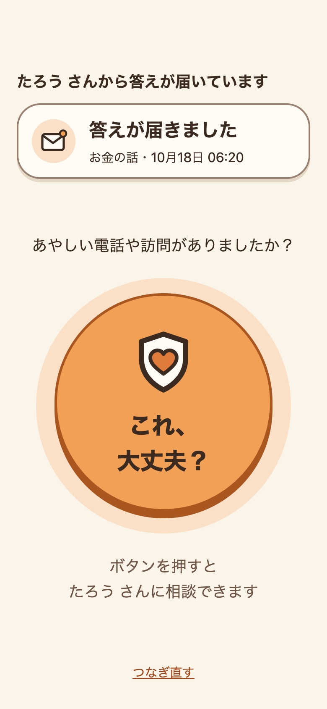
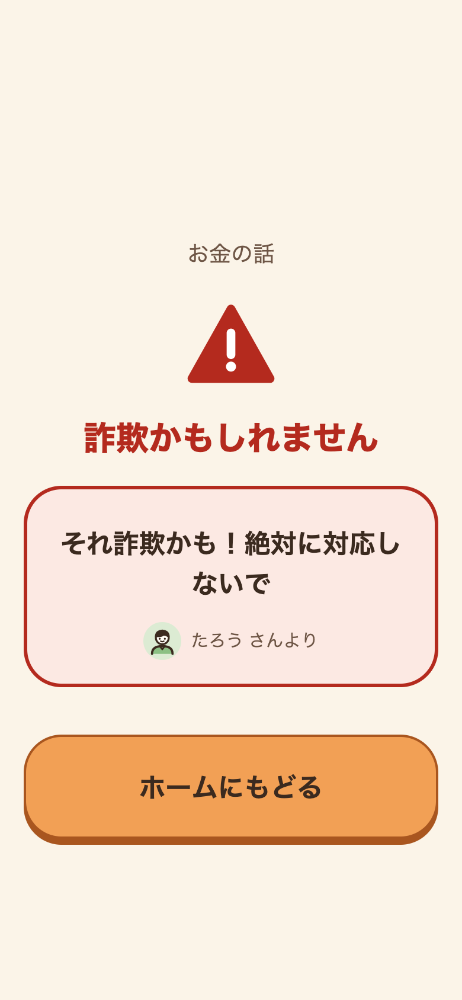

# これ、大丈夫？

高齢の親が、あやしい電話・訪問・SMS に出くわしたとき、大きなボタン1つで子にすぐ相談できる詐欺対策アプリ。




- 設計: [docs/DESIGN.md](docs/DESIGN.md)
- 技術: Expo (React Native + TypeScript) / Supabase（匿名サインイン・Postgres・RLS・Realtime）/ Expo Push（Database Webhook → Edge Function）
- 作り方の規則と、この repo で違うこと: [docs/DESIGN.md](docs/DESIGN.md#この-repo-での適用)

## いまの状態（Supabase 版）

- 入口: このスマホを「親のスマホ」「子のスマホ」のどちらで使うかを選ぶ。親も子も匿名でサインインする（メールもパスワードも打たない）
- ペアリング: 子のスマホに 6 桁の番号（10 分・使い切り）が出る。子が親のスマホの数字キーで打つとつながる。まちがいが 10 分で 5 回に達すると断る
- 親フロー: ホーム →「これ、大丈夫？」→ 種類選択 → 相談中 → 答え（ホームに最近の相談の入口が最大3件。まだ開いていない答えは大ボタンより上に出る）
- 子フロー: 受信一覧 → 詳細 → 定型文、または自由入力（200字まで）＋判定（詐欺かも / 大丈夫そう / まだ分からない）で返信
- データは Supabase（`supabase/migrations/`）。相談と返信は Realtime で相手の画面に再読み込みなしで出る。送れなかったときは手元の表示を元に戻す
- 相談が届くと子のスマホに、返事が届くと親のスマホにプッシュ通知を送り、押すとその相談を開く（開発ビルドの実機だけ。実機での到達はまだ確かめていない）
- 開発中に Supabase の設定が無いときは、端末内の偽バックエンドで動く（Web は 2 タブで親と子の往復を試せる）
- 親のホームと子の受信一覧の一番下に「つなぎ直す」がある（スマホを替えたときなどに、もう一度番号でつなぐ）
- 開発用に、ペアリングの画面の下に「最初からやり直す」（新しい匿名ユーザーで役割の選択から）がある

## 動かし方

Node は `.nvmrc` の版（24 系）を使う。react-native 0.86 の `engines` は 24 系なら 24.3.0 以上を求める。

```sh
nvm use            # .nvmrc の Node に切り替え（未導入なら nvm install）
npm install        # 初回のみ
npm start          # Expo 開発サーバーを起動
```

Supabase につなぐときは、repo の直下に `.env.local` を作り、次の 2 つを書く（`.env*.local` は git に入らない）。

```sh
EXPO_PUBLIC_SUPABASE_URL=https://<プロジェクト>.supabase.co
EXPO_PUBLIC_SUPABASE_ANON_KEY=<anon key>
```

開発中（`npm start` / `npm run web`）に 2 つがそろっていなければ、Supabase の代わりに端末内の偽バックエンドで動く（起動時にコンソールへ警告を 1 回出す）。Web では偽バックエンドのデータを localStorage に置き、タブごとに別の利用者になるので、同じブラウザの 2 タブで親と子の往復を試せる。iOS / Android の偽バックエンドはメモリだけで、アプリを閉じると消える。anon key はアプリに入る公開の鍵で、守りは DB の RLS が担う。

本番の書き出し（`npx expo export` や EAS のビルド）では偽バックエンドに切り替えない。2 つのどちらかが欠けていると、起動画面に「設定がありません」と出て先へ進まない（送れたように見えて届かない、を防ぐため）。
書き出しでも偽バックエンドで動かしたいときは、`EXPO_PUBLIC_BACKEND=fake` を明示する。

整形の検査は `npm run format:check`、lint は `npm run lint`（eslint + eslint-config-expo）、型チェックは `npm run typecheck`、テストは `npm test`。テストは画面に依存しない純関数のほか、`tests/rls.test.mjs`（移行 SQL を PGlite に流し、RLS・招待の規則・返信と status の整合を検査）と `tests/backend.test.mjs`（偽バックエンドの招待と役割の規則、Supabase 版が呼ぶ表・関数・購読の filter と、それが移行 SQL に実在すること）、`tests/store-sync.test.mjs`（送れなかったときに表示を戻すこと）を含む。main への push と pull request では、GitHub Actions（`.github/workflows/ci.yml`）がこの 4 つを順に走らせます。

起動後、ターミナルに QR コードが出ます。

- iPhone: App Store で **Expo Go** を入れ、カメラで QR を読む
- Android: **Expo Go** を入れ、アプリ内の QR スキャンで読む

同じ Wi-Fi につないでおくこと。

### ブラウザで動かす（Web）

```sh
npm run web        # Expo 開発サーバーを起動してブラウザで開く（既定は http://localhost:8081）
```

スマホがなくても、ブラウザで一往復の流れを確かめられます。

## 一往復のテスト（ブラウザの 2 タブで）

1. タブ A で「子のスマホ」を選ぶ → 6 桁の番号が出る
2. タブ B で同じ URL を開き「親のスマホ」を選ぶ → 番号を数字キーで入れると、親のホームになる（タブ A は受信一覧に変わる）
3. タブ B で「これ、大丈夫？」→ 種類を選ぶ →「〜さんに相談しています…」になる
4. タブ A に再読み込みなしで相談が届く。開いて返信する（定型文をタップ、または自分の言葉を書いて判定を選び「この内容で送る」）
5. タブ B に再読み込みなしで答えが出る

つないだあとで組み直すときは、両方の端末で「つなぎ直す」を押して、もう一度番号で結ぶ（前の相談は見えなくなる）。つなぐ前なら、ペアリングの画面の「最初からやり直す」か、ブラウザの localStorage を消す。Supabase につないだときは、2 台のスマホ（またはスマホとブラウザ）で同じ流れになる。

## Supabase の準備

1. [Supabase](https://supabase.com/) で新しいプロジェクトを作る（無料のプランでよい）
2. Anonymous sign-ins（匿名サインイン）をオンにする（Authentication の設定の中。画面の位置はこの repo では確かめていない）
3. SQL Editor で `supabase/migrations/` の 2 本を名前の順に流す（`20261016000000_init.sql` → `20261016000001_realtime.sql`）
4. プロジェクトの URL と anon key（公開用の鍵）を、上の `.env.local` に書いて `npm start` し直す

## プッシュ通知の準備

送る側は `supabase/functions/notify/`（中身は Deno に依存しない `core.ts`、入口は `index.ts`）。相談の INSERT で子へ「親から相談：<種類>」、返信で answered になった UPDATE で親へ「返事が届きました」を送り、送った結果（ticket）を push_log に残す。

1. 開発ビルドを用意する。SDK 53 以降の Expo Go ではプッシュを試せず、Web は expo-notifications の対応先に無い。アプリは expo-device の `isDevice` が true で、かつ Expo Go（`Constants.executionEnvironment` が `storeClient` で `Constants.appOwnership` が `expo`）でないときだけトークンを取る（`src/domain/push.ts`）
2. EAS の projectId を `app.json` の `expo.extra.eas.projectId` に入れる（`eas init` で入る）。無ければアプリは警告を 1 回出してトークンを取らない
3. Edge Function を置く: `supabase functions deploy notify`。Webhook は利用者の JWT を持たないので、`supabase/config.toml` の `[functions.notify]` に `verify_jwt = false` を書く（守りは下の秘密のヘッダ）。Function はフォルダの外を読まず、種類の名前・アプリ名・通知の data の名前は同じフォルダの `shared.ts`（アプリの正本から作る写し）から読む
   - 種類の名前やアプリ名を変えたら `npm run gen:notify` を打って `shared.ts` を作り直す（CI のテストが写しと正本の一致を確かめる）
4. 秘密を 2 つ入れる: `supabase secrets set NOTIFY_WEBHOOK_SECRET=<長い乱数> EXPO_ACCESS_TOKEN=<Expo の access token>`。`EXPO_ACCESS_TOKEN` は任意で、EAS の設定で送信に access token を求めるようにしたときに要る。`SUPABASE_URL` と `SUPABASE_SERVICE_ROLE_KEY` は Edge Function に最初から入っている
5. Database Webhook を作る（Database → Webhooks）: 表は `public.consultations`、出来事は Insert と Update、送り先は POST で `https://<プロジェクトの ref>.supabase.co/functions/v1/notify`、ヘッダは `Content-Type: application/json` と `x-notify-secret: <NOTIFY_WEBHOOK_SECRET と同じ値>`。URL にプロジェクト固有の値が入るので、移行 SQL には書いていない
6. 確かめ方: 開発ビルドの実機 2 台で相談と返信をし、push_log に `status = ok` の行が増えることを見る（ok は Expo が受けた印で、届いた印ではない）

## 既知の制限

- 送った直後の 1 件の取り直しに失敗すると、次に一覧を取り直すまで、その 1 件は端末の時刻の版で並ぶ（DB の時刻ではない。ずれるのは並び順だけ）
- 端末に保存したセッションが読めなくなったときは、新しい利用者を作らずに起動画面のエラーで止まる（作ると元のペアから黙って外れるため）。電波の問題なら「もう一度」で戻るが、セッションが失われていた場合は、起動画面の「つなぎ直す」で新しい利用者として始め直す（相手の端末でも「つなぎ直す」を押して、もう一度番号で結ぶ）

## この先の予定

1. プッシュ通知を実機で確かめる（開発ビルドと EAS の準備が要る。届いたかの確認 receipt はまだ見ていない）
2. 写真添付（ハガキ/SMSを撮る）
3. 親UIの磨き込み・実地テスト
4. ペアの解除（いまの「つなぎ直す」は新しい利用者で結び直すだけで、前のペアは DB に残る）
